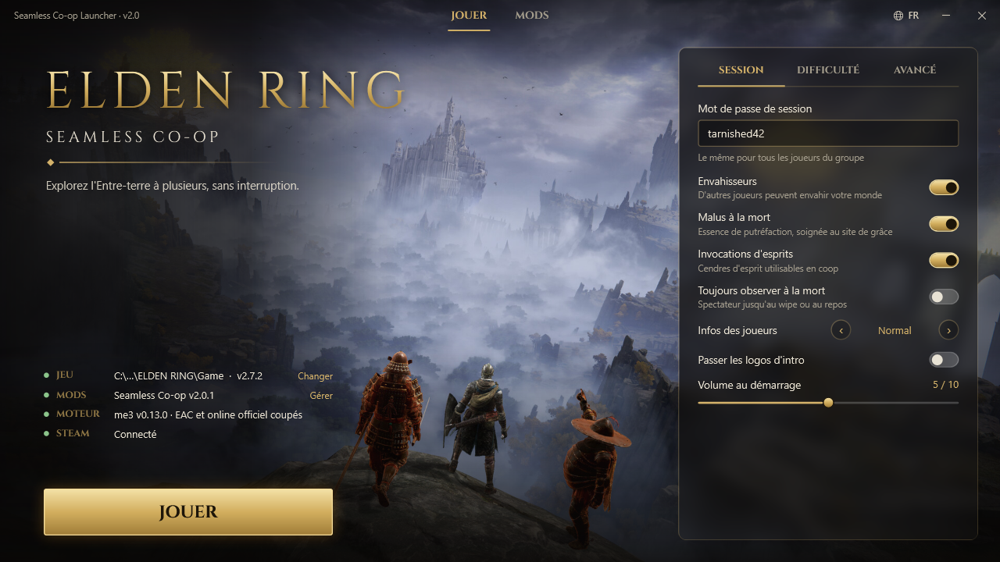

# Elden Ring – Seamless Co-op Launcher

Un seul fichier : `EldenRing-SeamlessCoop-Launcher.exe` (~850 Ko, aucune installation, .NET Framework 4.8 déjà présent dans Windows 10/11).



## Télécharger

1. Télécharge `EldenRing-SeamlessCoop-Launcher.exe` dans la [dernière release](../../releases/latest).
2. Lance-le.

L'exe n'est pas signé, donc Windows SmartScreen peut afficher « Windows a protégé votre ordinateur ». Clique alors sur « Informations complémentaires », puis « Exécuter quand même ».

## Ce qu'il fait

- **Trouve le jeu tout seul** : il cherche dans toutes les bibliothèques Steam, et sinon tu cliques sur « Localiser » pour lui indiquer `eldenring.exe`. Il lit aussi la version du jeu (ex. v2.7.2).
- **Plusieurs mods en même temps**, grâce à [me3](https://github.com/garyttierney/me3) (ModEngine 3), installé et mis à jour automatiquement :
  - le jeu est lancé sans Easy Anti-Cheat et sans connexion aux serveurs officiels de FromSoftware ;
  - les mods restent dans `%LOCALAPPDATA%\ERSeamlessLauncher`, et le dossier du jeu reste vanilla ;
  - le bouton « Jouer » de Steam lance toujours la version normale avec EAC.
- **Page Mods** :
  - **Catalogue** : les mods vérifiés du fichier [`catalog.json`](catalog.json) de ce dépôt, séparés entre « compatibles avec ta version » et « non vérifiés ». Il contient Seamless Co-op, 9 mods DLL installables en un clic (FPS, champ de vision, caméra, aberration chromatique, vignette, distance d'animation, ultra-large, perte de runes, verrouillage libre) et Map for Goblins Expanded (Nexus) ;
  - **Installés** : activer ou désactiver, ordre de chargement, réglages, « Testé OK », désinstaller ;
  - **Découvrir** : recherche parmi les mods Nexus, sans compte et sans contenu adulte. Un mod Nexus se télécharge sur leur site, puis s'ajoute avec « Importer un .zip » ou « Importer un dossier ».
- **Compatibilité avec le jeu** : après une mise à jour du jeu, les mods qui ne sont pas vérifiés pour la nouvelle version sont désactivés automatiquement, pour éviter les plantages.
- **Compatibilité entre mods** : deux mods vraiment incompatibles ne peuvent pas être activés ensemble. Quand l'un est actif, l'interrupteur de l'autre est verrouillé et la raison est affichée. Sont concernés :
  - les incompatibilités vérifiées et déclarées dans le catalogue ;
  - deux mods qui remplacent les mêmes fichiers du jeu, détectés automatiquement (deux `regulation.bin`, deux textures de Malenia…).
- **Mises à jour automatiques** des mods hébergés sur GitHub et de me3, avec vérification SHA-256 et conservation de tes réglages.
- **Réglages de chaque mod** depuis le launcher : ceux de Seamless sur la page Jouer, ceux des autres mods dans leur fenêtre « Réglages ». Ils sont décrits dans le catalogue, ou déduits automatiquement du `.ini` du mod.
- **Import intelligent** : il repère les DLL, les dossiers de fichiers du jeu (`regulation.bin`, `chr/`, `parts/`…) et la config des mods « Elden Mod Loader ». Il ignore le vieux chargeur `dinput8.dll`, puisque me3 le remplace.
- **Sauvegardes** :
  - ta progression vanilla est copiée vers Seamless à la 1re installation ;
  - une copie de sécurité est faite avant chaque partie (les 10 dernières sont gardées) ;
  - le `.sl2` vanilla n'est jamais modifié.
- **Trois langues** (français, anglais, espagnol), y compris les traductions du mod Seamless lui-même.

## Bon à savoir

- **Coop** : tous les joueurs doivent avoir la même version de Seamless, le même mot de passe, et les mêmes mods marqués « Gameplay ».
- **Antivirus** : Seamless et me3 s'injectent dans le jeu, donc Windows Defender les signale parfois (faux positif). Si le launcher dit que des fichiers ont disparu, ajoute une exclusion pour `%LOCALAPPDATA%\ERSeamlessLauncher`.
- **En secours** : si me3 pose problème, l'onglet Avancé propose le moteur « Seamless seul ». Il utilise `ersc_launcher.exe` comme avant, sans les autres mods.
- **Archives `.7z` / `.rar`** : extrais-les, puis utilise « Importer un dossier ».
- **Ancienne version** : à la mise à jour depuis la v1, tes réglages Seamless (mot de passe, etc.) sont repris. Le launcher propose ensuite de nettoyer l'ancienne installation dans le dossier du jeu.
- **Changer de fond** : pose une image `launcher-background.jpg` (ou `.png`) à côté de l'exe.

## Ajouter des mods au catalogue

Voir [docs/CATALOG.md](docs/CATALOG.md). Il suffit de modifier `catalog.json` sur la branche `main` : tous les launchers le récupèrent au démarrage, sans recompiler.

## Recompiler

```powershell
powershell -ExecutionPolicy Bypass -File build.ps1
```

Le build utilise `csc.exe` fourni avec Windows. Les sources sont dans `src/`, les ressources dans `assets/` et le banc d'essai dans `tests/`. `tools/verify-patches.py` vérifie les mods DLL du catalogue sur une version du jeu (voir [docs/CATALOG.md](docs/CATALOG.md)).

## Crédits et licence

Projet de fan non officiel, sans lien avec Bandai Namco, FromSoftware, l'auteur de Seamless Co-op ni les auteurs des mods du catalogue.

- Seamless Co-op © Yui (LukeYui) et me3 © garyttierney et contributeurs. Ils sont téléchargés depuis leurs dépôts officiels et ne sont pas inclus ici.
- Mods du catalogue : leurs auteurs respectifs, téléchargés depuis leurs dépôts officiels.
- Traductions du mod Seamless (`assets/locale`) : communauté Seamless Co-op, crédits dans chaque fichier. Elles ont été complétées pour la v2.0.1.
- Image de fond : capture officielle d'Elden Ring (Steam), © Bandai Namco / FromSoftware.
- Police Cinzel sous licence SIL OFL (`assets/Cinzel-OFL.txt`).
- Le code du launcher est sous licence MIT (voir `LICENSE`). L'image, la police et les traductions gardent leurs propres droits.
